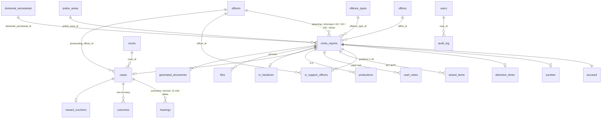

# Database design (A2)

SQLite now, PostgreSQL later (REWRITE_PLAN §3). Schema: [`packages/db/migrations`](../../packages/db/migrations). Code: [`packages/db`](../../packages/db).

## Rules for every table

| Rule | How |
|---|---|
| Records made on different PCs never collide | `id` is a UUID (text) |
| Sync and conflict handling later | `created_at`, `updated_at` (ISO-8601 UTC), `updated_by` (user id), `version` (bumped on every change), `deleted_at` (soft delete) |
| Real dates | ISO `YYYY-MM-DD` text with `CHECK (date(x) = x)`; shown as `YYYY.MM.DD` by the UI and documents |
| No floating-point money | fines in integer cents (`fine_amount`) |
| Names change in one place | records hold reference ids (foreign keys), never the name |
| CR number unique per office and year | partial unique index on live rows: `(office_id, cr_year, cr_number) WHERE deleted_at IS NULL`, so a deleted CR's number can be reused |

## Tables

### Reference lists (the 14 lists of `menu form4`)

| Table | Lists | Columns beyond the sync columns |
|---|---|---|
| `offices` | office / unit (`Table office`) | `name`, `active` |
| `years` | CR year (`Table year`) | `name` (4 digits), `active` |
| `offence_types` | offence (`Table offence`) | `code` (unique among live rows), `name_si`, `template_group`, `active` |
| `officers` | detecting, informant, prosecuting, support, AC, SC, OIC, driver | `kind`, `name`, `rank`, `active` |
| `courts`, `police_areas`, `divisional_secretariats` | court, police area, divisional secretariat | `name`, `active` |

An item in use (by any CR, deleted ones included) is deactivated, never deleted. View `v_reference_items` lists all 14 as one.

### Crime report and children (legacy `Office` table, §11)

| Table | Legacy columns |
|---|---|
| `crime_reports` | `CR NO 2017`, `YearCR`, `snocr` (→ `cr_seq`), `office`, `month`, `fistsecon` (→ `half_year`), `Date of Detection`, `Place of Detection`, `Offence`, `polise unit`, `prale name`, `detection officer`, `Informan`, `Ac`, `Sc`, `oic`, `Drive`, `Quantity`, `Quantity1`, `Over Quantity`, `place of cash`, `Cash Number`, `Cash Number 1`, `infor help`, `infor 2`, `Accused note`, `incedent` (→ `notes`) |
| `accused` | `Name of Accused`, `Address of Accused`, `NIC No of Accused`, `Age`, `Hight`, `male female`, `Accused details` (→ `features`), `deno` (phone), `driveno`, `forinno` |
| `sureties` | `Name of Suerty`, `Address of Suerty`, `NIC Suerty`, `beno` (phone) |
| `detection_times` | `Time of Arraival`, `Time of B/C leaving`, `Time of IPR leaving`, `Time of Detection`, `Time after detection` (kept as typed: `14.45` and `14:45` both occur) |
| `cr_support_officers` | `dh1`–`dh5` (positions 1–5), `inh1`–`inh5` (6–10) |
| `seized_items` | `sp1`–`sp15`: one row per item type with its unit |
| `cash_notes` | `Cash 5000`…`Cash 10` (used), `Cash1 5000`…`Cash7 10` (left): note serials as typed |
| `productions` | `Production list`, `Production1`, `Production2` |

### Case progress (legacy `Result` form)

| Table | Legacy columns |
|---|---|
| `cases` | `Name of Court`, `Date of Court`, `court officer`, `Case no`, `T/R` / `WT` / `calling` (→ `case_type`), `sithasi`, `nochage` (→ `permission_pending`), `reject` (→ `withdrawn`), `deth` (→ `accused_died`), `volum no`, `volum p`, `index p`, `index sn` |
| `hearings` | `calling date` + `calling date m`, `W/T date` + `W/T date m`, `T/R date` + `T/R date m`, `T/R date1`–`20` + `m1`–`m20` |
| `outcomes` | `result` (fine, cents), `fine date`, `praja`, `cell` + `celldatem` + `celldated`, `cellbrake`, `wrelese`, `samatha`, `pariwasa`, `punuru`, `rajaya`, `indepen1`, `indepen2`, `taking`, `takecort`, `cjreport`, `resitno`, `resitdate`, `type` (→ `add_to_convict_register`) |
| `reward_vouchers` | `rewardgive` |
| `cr_handover` | `newcr`, `crpersan`, `crhdate` |

Not stored yet (no field in the new system; the importer counts them): `Bottle type`, `casenyear`, `casenmonth`.

### Other tables

| Table | Purpose |
|---|---|
| `users` | accounts: `username` (unique), Argon2 `password_hash`, `role`, `active`, `failed_attempts`, `must_change_password` |
| `audit_log` | append-only: `at`, `user_id`, `action`, `table_name`, `row_id`, `before_json`, `after_json` (never password hashes) |
| `files` | pictures: original name, type, size, `stored_name` in the file store |
| `document_templates` | D's registry (seeded from `templates.json`) |
| `generated_documents` | D's generation log |
| `schema_migrations` | which migrations ran |

### Views

- `v_reference_items`: the 14 lists as one.
- `v_report_rows`: one row per live CR with its case, names, fine total, first convicted date, convicts-register flag. Every report filter (§1.6) runs on it; outcome types and seized items are read per CR alongside.

## Indexes and performance (A6)

Indexes cover every search: office + year + month, office + detection date, court date, court + case number, accused name (case-insensitive) and NIC, offence, detecting officer, informant, outcomes by case and convicts flag, audit by time, row and user.

`pnpm db:load-test` seeds 100,000 CRs (about 12,500 a year) and times every search and report. Result on the development PC (2026-10-20): every search and report under 0.5 s; slowest the yearly summary by offence (458 ms) and the court-date search (451 ms).

## Migrations

Plain SQL in `packages/db/migrations`, applied in name order on start-up (`ExciseDb.migrate`), each in its own transaction, recorded in `schema_migrations`. They are embedded in the app bundle (no `.sql` files to ship). CI applies them to a fresh database and runs SQLite's integrity and foreign-key checks. Never edit a migration that has shipped; add a new one.

## SQLite ↔ PostgreSQL

What changes for the hosted version (A15 lists the exact differences):

| SQLite here | PostgreSQL |
|---|---|
| `TEXT` UUIDs, dates, timestamps | `uuid`, `date`, `timestamptz` |
| flags `INTEGER` 0/1 with `CHECK` | `boolean` |
| `CHECK (date(x) = x)` | not needed with `date` columns |
| `COLLATE NOCASE` index on accused name | `lower(name)` expression index or `citext` |
| `rowid` ordering for cash notes | add a `position` column |
| `VACUUM INTO`, `PRAGMA integrity_check` (backup) | `pg_dump` / managed backups |
| one connection, `AsyncLocalStorage` transactions | pooled connections; same `transaction(fn)` API |

The repositories use Kysely, so most queries carry over; raw SQL is limited to the views, `usageCount` and the backup steps.
